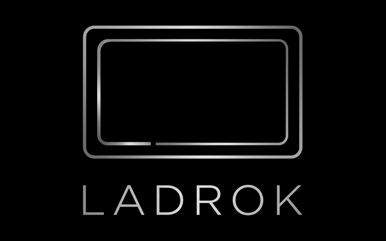

<p align="center"></p>

# Ladrok TV

Android TV (AOSP 17) for the **Raspberry Pi 5**, based on [raspberry-vanilla](https://github.com/raspberry-vanilla) (KonstaKANG's AOSP device trees), with:

- **A quiet home screen**: [Ladrok Launcher](https://github.com/Kordal/ladrok-start). Watch Next and the Channels you pick on the left, your apps as a phone-style keypad on the right (digits 1–9 open them).
- **An app store**: [Ladrok Store](https://github.com/Kordal/ladrok-store). A short, curated list of TV apps from their GitHub releases (and F-Droid), installed and kept up to date without prompts.
- **First-boot setup**: language, country and time zone, using the TV remote. The country sets the Wi-Fi regulatory domain, so 5 GHz channels work. Nothing is hard-coded to a region.
- **Over-the-air updates (A/B)**: the system updates in the background while you keep watching. A signed package is installed into the inactive slot by `update_engine`, then the TV restarts into it. If the new version doesn't start, the Pi firmware boots the previous one again.
- **/data fills the card**: on first boot, the user data partition grows to the end of the SD card.

This is a hobby project: a `userdebug` build with SELinux permissive. It is tested on a Pi 5 (8 GB) booting from an SD card into a 1080p TV over HDMI.

## Install

1. Download `ladrok-tv-<date>.img.xz` from the [latest release](../../releases/latest) when one is attached, or build it yourself (see below).
2. Write it with [Raspberry Pi Imager](https://www.raspberrypi.com/software/): *Choose OS → Use custom*. Choose **No** when it offers OS customisation. This erases the card.
3. Boot the Pi. Pick your language, country and time zone, then connect to Wi-Fi in Settings.

After that, updates arrive through **Settings → About → System update**, also listed as *System update* among the apps. The TV checks once a day, downloads in the background, and asks before installing and before restarting.

## How updates work

```
 SD card (GPT)
 p1  bootsel     FAT: only autoboot.txt (which slot the firmware boots)
 p2  rpiboot_a   FAT: kernel, ramdisk, config.txt, cmdline_a/b.txt   ┐ slot A
 p5  system_a    p7 vendor_a                                         ┘
 p3  rpiboot_b   p6 system_b   p8 vendor_b                             slot B
 p4  misc        slot metadata
 p9  metadata    p10 userdata
```

- The Pi firmware reads `autoboot.txt` on p1. `[all] boot_partition=` names the normal slot. `[tryboot] boot_partition=` names the slot to try once after the one-shot *tryboot* flag is set.
  The same boot files serve both slots. `config.txt` uses `[boot_partition=2|3]` to choose `cmdline_a.txt` or `cmdline_b.txt`, which pass `androidboot.slot_suffix`.
- The boot control HAL (`device/brcm/rpi5/boot_control`) works as follows:
  - `setActiveBootSlot(other)` writes the `[tryboot]` entry and sets the tryboot flag through the VideoCore mailbox.
  - `markBootSuccessful()` runs after a good boot of the new slot and makes that slot the `[all]` default.
  - A crash, a panic (`panic=10`), or a power cut before that point leaves the old slot as the default.
  - `autoboot.txt` has a fixed size of 512 bytes and is rewritten in place, one sector at a time, so the FAT itself never changes.
- **Update packages** are normal AOSP A/B OTA zips (`ota_from_target_files`). They are published as GitHub release assets together with an `update.json` (version, SHA-256, payload offset/size/properties). The updater app (`LadrokUpdater`) downloads both and hands the payload to `update_engine`.
- **Signing**: the device only trusts `device/brcm/rpi5/security/ota.x509.pem`. The stock `otacerts.zip`, which also contains the public AOSP test key, is replaced with a bind mount at boot. The private key is not in this repository.

## Build from source

You need Linux, or WSL2 on Windows, with Ubuntu 24.04, about 400 GB of free disk, 32 GB of RAM or more, and the [AOSP build dependencies](https://source.android.com/docs/setup/start/requirements). You also need `repo`, `sgdisk`, `mtools` and `dosfstools`.

```bash
git clone https://github.com/Kordal/ladrok-tv && cd ladrok-tv
bash scripts/sync.sh            # AOSP 17 + raspberry-vanilla manifests into ~/aosp-rpi (shallow)
bash scripts/apply-patches.sh   # our changes, from patches/
bash scripts/build.sh           # images + ladrok-tv-<date>.img (GPT, A/B) in the repo root
```

Flash it with Raspberry Pi Imager. On Windows you can also run `scripts\flash-sd.ps1` from an elevated PowerShell. It backs up the card, writes the image and verifies it.

### Publishing your own updates

If you build your own images, use **your own** update key and release repository. Otherwise devices running your build would accept updates from this project.

1. Create a key:
   ```bash
   mkdir -p ~/ladrok-keys && cd ~/ladrok-keys
   openssl genrsa -out ota.key 4096
   openssl req -new -x509 -sha256 -key ota.key -out ota.x509.pem -days 10950 -subj '/CN=my OTA key'
   openssl pkcs8 -in ota.key -topk8 -outform DER -out ota.pk8 -nocrypt
   cp ota.x509.pem ~/aosp-rpi/device/brcm/rpi5/security/ota.x509.pem
   ```
   Back up `~/ladrok-keys`. Without it, devices running your build can only be updated by reflashing.
2. Set `release_repo` in `device/brcm/rpi5/LadrokUpdater/res/values/strings.xml` to your `owner/repo`.
3. Build a release with `bash scripts/make-ota.sh`. It writes a signed `ladrok-tv-ota-<timestamp>.zip` plus `update.json`. Attach both files to a GitHub release, and devices will pick it up within a day.

## Repository layout

| Path | What |
|---|---|
| `patches/` | Changes to the AOSP tree, one patch per project (`device/brcm/rpi5`, `device/google/atv`, `build/make`) |
| `scripts/` | sync, apply/export patches, build, `mkimg-ab.sh` (card image), `make-ota.sh` (signed OTA), flash scripts |
| `tools/` | `connect.ps1` (wireless adb via mDNS), `ab-status.sh` (slot and tryboot state on the device), `test-fallback.sh` (rollback test), `ota-sideload.ps1` (install an OTA over adb), `make-release-image.sh` (`.img.xz` for a release), `make-logo-assets.py` (boot animation and icons from the logo) |
| `docs/` | The logo (`ladrok-logo-source.png` is the original artwork) |

## Credits and license

Built on the [Android Open Source Project](https://source.android.com/) and the [raspberry-vanilla](https://github.com/raspberry-vanilla) Raspberry Pi device trees by KonstaKANG.
Our own code and the patches are released under the Apache License 2.0 (see `LICENSE`), the same license as the projects they modify.
